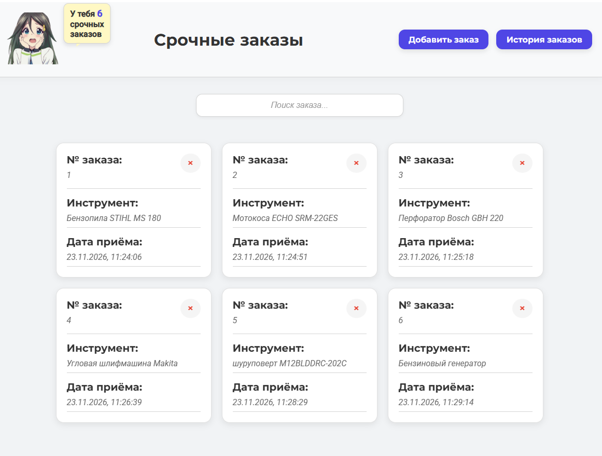
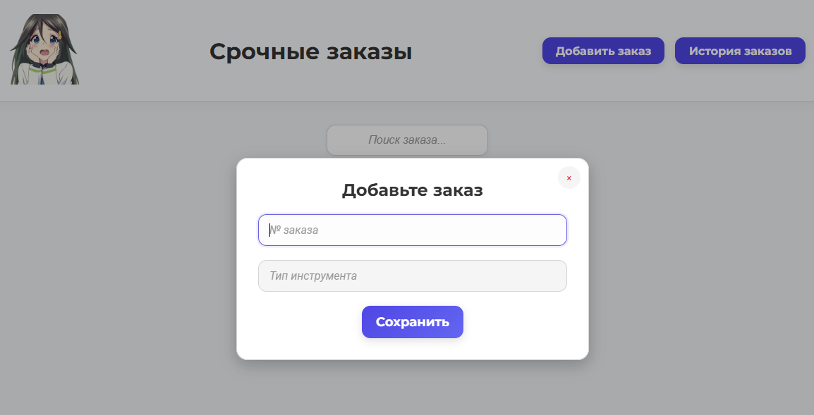
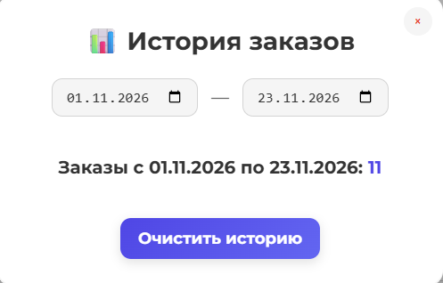

# Urgent Orders — Desktop Application

A desktop application for managing urgent orders. Built with React and TypeScript, wrapped in Electron.

## About

The application helps organize and manage urgent orders through a desktop interface. It was developed as a personal project to practice React, TypeScript, application architecture, testing, and desktop development with Electron.

## Screenshots

### Main Screen


### Add Order


### Orders History


## Features

- Create and manage orders
- View and organize orders in a list
- Search for orders
- Manage order data through a React interface
- Persist data locally using `localStorage`
- Desktop application built with Electron

## Tech Stack

- **React**
- **TypeScript**
- **Vite**
- **Electron**
- **Context API**
- **CSS Modules**
- **Vitest**
- **React Testing Library**
- **Playwright**
- **ESLint**

## Testing

The project includes several levels of testing:

- Unit tests
- React component tests
- Integration tests
- End-to-end tests with Playwright

## Development

Install dependencies:

```bash
npm install
```

Run the application in development mode:

```bash
npm run dev
```

Run unit and component tests:

```bash
npm run test
```

Run checks:

```bash
npm run check
```

Run end-to-end tests:

```bash
npm run test:e2e
```

Build the application:

```bash
npm run build
```

## CI

GitHub Actions is configured to run the build and Playwright end-to-end tests on pushes and pull requests.

## Project

Developed as a personal project for learning and practicing frontend and desktop application development.
